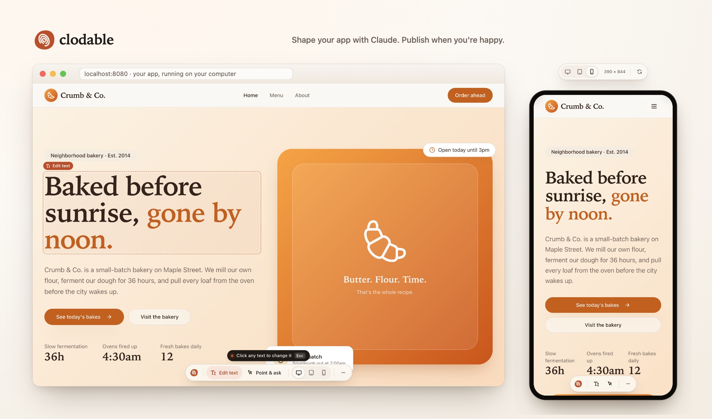
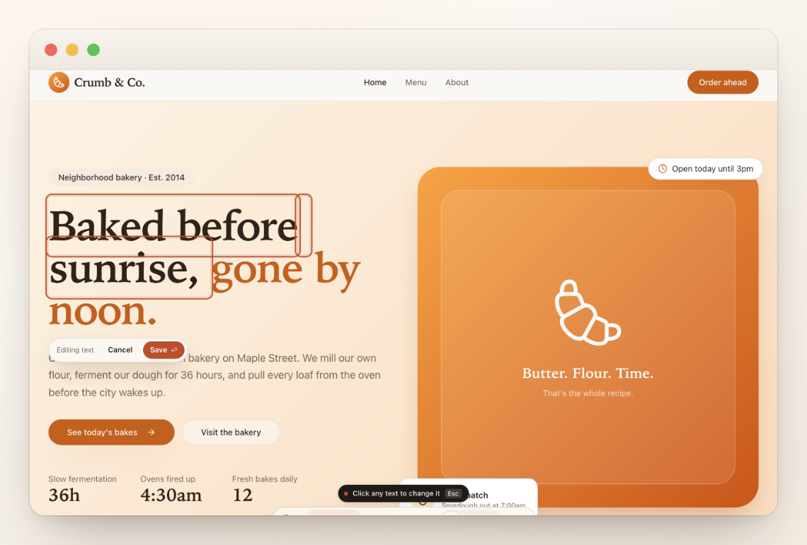
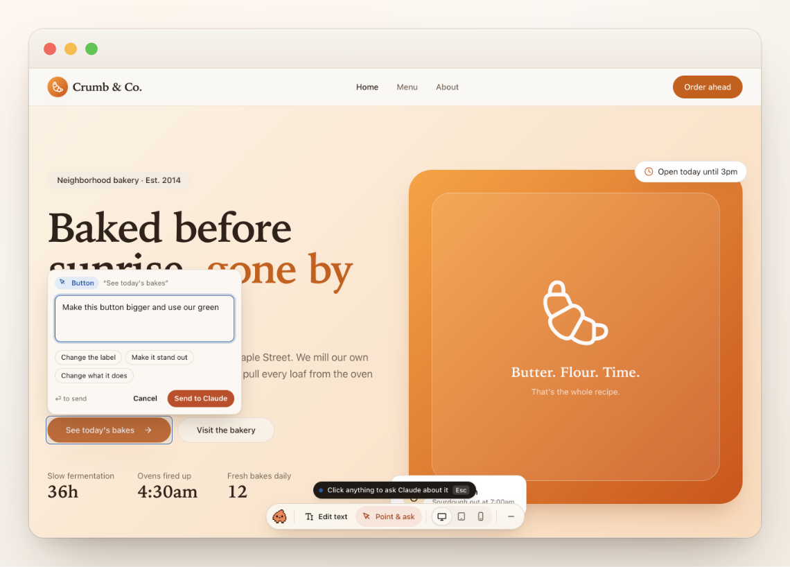
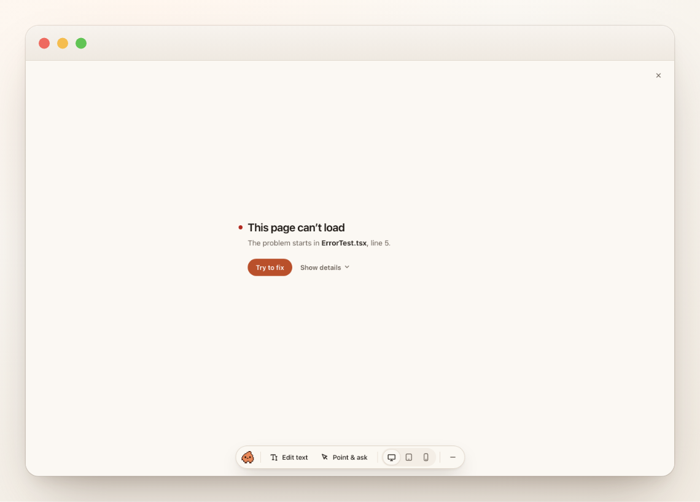
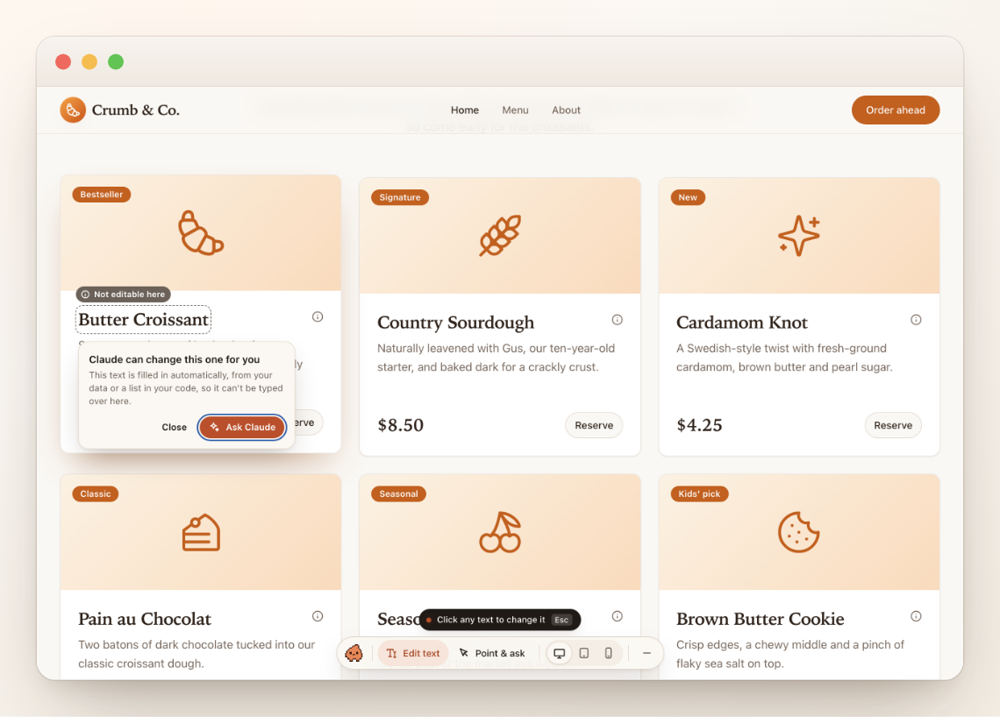

<p align="center">
  
</p>

<p align="center">
  <picture>
    <source media="(prefers-color-scheme: dark)" srcset="docs/assets/wordmark-dark.svg">
    
  </picture>
</p>

<p align="center">
  <b>The AI app builder you own.</b><br>
  Like Lovable, but on your own computer: open source, built on Claude Code, with every key in your name.
</p>

<p align="center">
  <a href="https://github.com/bworlds-co/clodable/actions/workflows/ci.yml"></a>
  <a href="https://www.npmjs.com/package/clodable"></a>
  <a href="LICENSE"></a>
</p>

<p align="center">
  
</p>

## Get started

**You'll need:**

- A Mac.
- [Claude Desktop](https://claude.com/download), up to date. To check, type `/status` in its **Code** tab: the **Claude Code** row should show 2.1.286 or later.
- A paid Claude plan.
- A GitHub account (free), where Clodable saves your app. An app you already have needs to be on it: Lovable [puts it there in one click](https://docs.lovable.dev/integrations/github).

The first run may ask to install Apple's developer tools, which takes a few minutes.

1. **Add Clodable to Claude Desktop.** Open **Customize › Plugins**, click **Add › Add marketplace › Add from a repository**, and enter `bworlds-co/clodable`. Then, under **Discover**, click **Add** next to Clodable.
   - You should see **Added** next to Clodable.
   - If Discover's search doesn't find Clodable, set its **Source** filter to **clodable**.
2. **Open an empty folder** in Claude Desktop's **Code** tab.
   - You should see the Clodable bar above the message box: “Describe your idea to Claude”, with **Bring an app from GitHub**.
   - If the bar doesn't show, type `/clodable`: the Clodable panel opens beside the chat. If the chat says “/clodable isn't a command here.” while the panel opens, carry on: Clodable is running.

Then start from an idea, or bring an app you already have.

### Start from an idea

1. **Describe your app** in the message box, in your own words. For example: “Make a simple app for sharing books with my neighbours. Start with sample books.”
   - You should see a first version in the preview beside the chat. Claude tells you it's only on this computer for now, and the bar says “Only on this computer”.
   - If Claude only talks it through, ask it to build a first version. If the preview doesn't open, ask Claude: “Show me my app's preview.”
2. **Keep it.** Press **Set up saving** in the bar, or tell Claude you want to keep your app.
   - You should see the panel name your GitHub account, “Save to @you · Private”. Nothing is created yet: check the app's name, then press **Create private app**. Clodable says “Saved to your private app on GitHub.”, and from then on saves your app after each of Claude's replies.
   - If the panel shows ✕ next to GitHub account, press **Connect GitHub** and enter the one-time code at github.com/login/device. If it shows **Install Git**, press it and follow Apple's window, then press **Check again**. If it says “Your local app needs a little preparation before saving.”, press **Ask Claude for help**, then **Create private app** again.
3. **Put it online, when you're ready.** The bar says “Not on the web yet”. Press **Set up hosting** and follow the panel: a free Netlify account, a token you paste in the panel, then **Create my web address**. Then press **Publish**.
   - You should see **You're live**, with your site's address.

When your app needs sign-in or data that people share, ask Claude: Clodable adds a backend on your own Supabase (free to start), after you choose the account in the panel.

### Bring an app you already have

1. **Press Bring an app from GitHub** in the Clodable bar.
   - You should see the Clodable panel beside the chat. The first time, it gets the tools it needs.
   - If the panel shows **Install Git**, press it and follow Apple's window, then press **Check again**.
2. **Bring your app in.** If the panel asks, press **Connect GitHub** and enter the one-time code at github.com/login/device. Paste your app's GitHub address, or press **Show my repositories** and pick it. Then press **Bring it in**.
   - You should see your app in the preview beside the chat, and “Your app is ready. Ask Claude for any change.” Claude then looks at your app and asks, one question at a time, what the code can't tell: where its data lives, and how its site goes live.

Putting your site online, adding a backend: Clodable sets them up in your own Netlify and Supabase accounts when you need them (both free to start). On Lovable Cloud, ask Claude to move you off Lovable, or type `/move-off-lovable` ([how it goes](#move-off-lovable-to-a-stack-you-own)).

Stuck? See [Troubleshooting](docs/TROUBLESHOOTING.md).

Already use Claude Code in Terminal? `claude plugin install clodable --marketplace bworlds-co/clodable` does step 1.

## Why Clodable

AI app builders like Lovable showed that anyone can build an app by describing it. Claude Code showed how much an AI can do when it works right in your code. Clodable brings the two together on your own computer: Lovable's simple way of building, the full power of Claude Code, and every account in your name.

**For builders who aren't developers.** If you can say what you want, you can shape your app: Claude makes the change, you see it in the preview beside the chat, and you publish when you're happy.

**All of Claude Code, made simpler.** Clodable is a plugin for Claude Code in Claude Desktop. Claude can change any file, add tables to your database, write backend functions and fix what breaks, and the skills, plugins and connectors you already use with Claude Code keep working. Clodable adds what a builder needs, like the live preview, the Publish button and Undo, and keeps the rest out of the way.

**Yours, down to the keys.** Your code is on your GitHub, your data in your own Supabase, your site on your own host. The keys to those accounts stay on your computer or in your own accounts, and Clodable never asks for them in the chat. Clodable has no server, no account and no paid tier: it's free and open source, under the MIT license. Stop using it any day, and your app keeps running exactly as it is.

**Coming from Lovable?** Clodable moves your app, your data and your users to accounts you own, step by step, while your live app keeps running. See [how the move goes](#move-off-lovable-to-a-stack-you-own).

**Still early.** Clodable works end to end, but it isn't perfect yet, and it changes fast. [Tell us what breaks](https://github.com/bworlds-co/clodable/issues).

<p align="center">
  <a href="#get-started">Get started</a> · <a href="#how-it-works">How it works</a> · <a href="docs/ARCHITECTURE.md">Architecture</a> · <a href="docs/DECISIONS.md">Decisions</a> · <a href="CONTRIBUTING.md">Contributing</a>
</p>

---

## What it feels like

<p align="center">
  &nbsp;&nbsp;
  &nbsp;&nbsp;
  &nbsp;&nbsp;
  
</p>

1. **Ask for a change in your own words.** "Make the header feel warmer", or "Add a pricing page with three plans."
2. **Watch it appear** in the live preview next to the chat. Once you've set up saving, Clodable saves your work after every reply.
3. **Click Publish** when you're happy. Clodable checks your app, then your site updates, usually within five minutes. While Lovable hosts your site, Publish ends at **Published on GitHub**, and you click Publish in Lovable to put it live.
4. **Changed your mind?** Undo puts the previous version back.

Clodable never uses git words: you see Saved, Publish and Undo. A developer, if you have one, finds a normal history on GitHub.

## What works today

Clodable is built and tested with apps it starts from your idea, and with apps made with **Lovable**:

- **Your app:** a new one Claude starts from your idea (a React app built with Vite), or either kind Lovable makes, a React app built with Vite or a TanStack Start app.
- **Your database:** your own Supabase project, or Lovable Cloud, which Clodable moves to a Supabase project in your name. No database yet? Clodable adds one on your own Supabase when your app needs sign-in or saved data.
- **Your site:** still on Lovable's hosting, on Netlify after the move, or on any host that deploys from GitHub, such as Vercel, Netlify or Cloudflare. Not online yet? Clodable puts it on your own Netlify, and each Publish updates it.
- **Your computer:** a Mac with Claude Desktop. Windows hasn't been tested yet, and the move off Lovable doesn't run there yet.

> **About Claude plans.** Pro and Max are personal plans. For your company's app, use **Claude Team or Enterprise**. In the European Economic Area and Switzerland, Anthropic's [consumer terms](https://www.anthropic.com/legal/consumer-terms) don't allow business use of personal plans. Helping a client set up? Follow the [onboarding playbook](docs/ONBOARDING.md).

Apps made with other AI app builders haven't been tested yet. A React app built with Vite may already work, since that's what Clodable's preview runs. Apps built with Next.js don't work yet. Moving off a builder works for Lovable only, for now.

## Move off Lovable, to a stack you own

<p align="center">
  
</p>

Your app, your data and your people move out of Lovable into accounts in your name. Clodable guides you step by step in its panel, and Claude does the technical work in the conversation. You click, decide, and paste your keys. Your live app keeps running on Lovable until you switch.

| On Lovable today | After the move |
|---|---|
| Lovable Cloud: your database, your people and their passwords, uploaded files, backend functions | Your own **Supabase** project |
| Lovable's hosting | Your own **Netlify** site, updated each time you Publish |
| Your domain | Points at your Netlify site: Clodable shows the records to change |
| Sign-up confirmations and password resets | Your own **Resend** account, sending from your domain |
| Lovable's AI | Your own key: OpenRouter, Google Gemini or OpenAI |
| Google sign-in, managed by Lovable | Your own Google sign-in, in your Google account |
| Lovable's connectors and app emails | Your own accounts with those services |
| Your code | On your GitHub, as it already is. Lovable's link to it is turned off at the end |

**How it goes:**

1. **Claude looks at your app** to see what it uses: AI, sign-in, emails, payments, scheduled jobs, uploads. You see what it found, and each step fits your app.
2. **You choose how to move.** *Carefully*, for an app people use: you try a working copy first, then your live app pauses for a few minutes while the latest data comes over, so nothing is lost. *In one go*, for a prototype: one export, and you're live on your own accounts.
3. **Get ready, beside your live app.** A copy of your data and people on your Supabase, which you can try in the preview. Your website, prepared on Netlify. Your emails, your AI key, your sign-in.
4. **Go live.** Clodable points your app at its new home, Publish puts it live, and your domain follows.
5. **Finish in Lovable**, once you've signed in on the new site: unpublish, disconnect GitHub, remove Lovable Cloud. The panel gives you the exact clicks, and a message for your users.

You'll create free accounts with Supabase, Netlify and Resend along the way, plus an AI provider or a Google sign-in if your app uses them. Your keys go into the Clodable panel and stay on your computer or in your own accounts. Clodable never asks for them in the chat. When a part is better done with someone technical, the panel says so up front. It's the same move for everyone, developers and agencies included.

## In the preview

<table>
  <tr>
    <td width="50%"></td>
    <td width="50%"></td>
  </tr>
  <tr>
    <td><b>Edit text in place.</b> Click any words and type. The change goes straight into your code, without AI and without using your Claude plan.</td>
    <td><b>Point & ask.</b> Click any part of the page and say what should change. Claude knows exactly which element and which line you mean.</td>
  </tr>
  <tr>
    <td></td>
    <td></td>
  </tr>
  <tr>
    <td><b>Try to fix.</b> If a page breaks, one click hands the error to Claude, with the page and the file.</td>
    <td><b>Honest about limits.</b> Text that comes from your data can't be typed over, so Clodable says so and offers to ask Claude.</td>
  </tr>
</table>

The tools start folded as **Tools** at the bottom of the preview: press it to open them. You can also preview your app at phone and tablet sizes, with real breakpoints. The toolbar only exists on your computer: visitors never see it.

## In Claude Desktop

Clodable adds a **Publish bar** above the message box. It tells you where you stand:

| You see | It means |
|---|---|
| `Only on this computer` **[Set up saving]** | Your new app isn't saved to GitHub yet |
| `● 3 changes not live yet` **[Publish]** | Your work is saved on GitHub, in your draft |
| `Publishing · Checking it builds…` | Clodable is putting it live, step by step |
| `● You're live · crumb.co` **[Undo]** | Visitors now see your changes |
| `Not published · A page doesn't build` **[Fix it]** | Nothing changed for visitors. Claude can fix it |

While Claude Desktop shows a question with choices to pick from, it hides the bar. **Open Clodable**, beside the message box, still opens the panel.

Claude's activity is written in plain words ("Updated the Pricing page", "Changed your database: add phone to customers"). Before anything touches your live data, Clodable asks you, and says plainly when a change can't be undone.

## How it works

```
YOUR COMPUTER · Claude Desktop
  1. Ask for a change
  2. Preview updates instantly
  3. Each reply is saved to your draft            ──▶  GitHub: draft/<you> + a pull request
        │
        │ 4. Publish: catch up with the live site → checks → merge
        ▼
PRODUCTION
  your host deploys main · edge functions go live · "You're live"
```

Underneath it's plain **GitHub Flow**: one draft branch per person, one pull request per draft, and `main` always equal to what's live. Everything Clodable does is a normal git commit, pull request or file, so a developer can open the hood and find nothing strange. See [docs/ARCHITECTURE.md](docs/ARCHITECTURE.md).

**Your database is the one exception.** Like Lovable, your preview uses your real data, and database changes apply when you confirm them. Claude is told to make them additive, so your live site keeps working until you publish.

## For developers

You need Node.js 20.19 or newer, pnpm 10 and git. `pnpm test:plugin` also needs the Claude Code CLI.

```bash
pnpm install
pnpm build        # design, core, preview, CLI bundle, and the plugin's copy of it
pnpm test         # every package (vitest) · plus `pnpm test:plugin` for the Claude plugin
pnpm lint && pnpm typecheck
```

**Run an example app with the toolbar**, straight from source. The examples are separate npm projects, so install one first:
```bash
npm ci --prefix examples/lovable-vite                    # or examples/lovable-tanstack
pnpm tsx scripts/dev-example.mts lovable-vite 5199       # or lovable-tanstack
```

**Try the whole flow without a GitHub account.** `scripts/demo-workspace.mts` makes a demo: the bakery example with Clodable set up, a local stand-in for GitHub, and two saves waiting to be published. It deletes and recreates the folder you give it (by default `~/Clodable Demo`), so name a new one. After `pnpm build` and the `lovable-vite` install above:
```bash
pnpm tsx scripts/demo-workspace.mts /tmp/clodable-demo
```
It prints how to open the demo in Claude Desktop. To publish from the terminal instead:
```bash
cd /tmp/clodable-demo/crumb-site
export CLODABLE_FAKE_GITHUB=/tmp/clodable-demo/.github-fake/crumb-site.git
node <repo>/packages/cli/dist/clodable.mjs publish
```

**Use your checkout in Claude Desktop and the terminal while you work on it.** Install it once from the folder:
```bash
claude plugin install clodable --marketplace "$PWD"
```
In the terminal, Claude Code reads the plugin straight from `plugin/` here, so your edits apply at the next session or `/reload-plugins`. Claude Desktop loads the copy made at install time instead (`~/.claude/plugins/cache/clodable/clodable/<version>`), so point that copy at your checkout once:
```bash
d=$(ls -d ~/.claude/plugins/cache/clodable/clodable/*/ | head -1); rm -rf "$d" && ln -s "$PWD/plugin" "${d%/}"
```
Clodable only acts in apps it set up, so your other projects are unaffected. To remove it: `claude plugin marketplace remove clodable`.

| Package | What it is |
|---|---|
| [`packages/core`](packages/core) | The engine: drafts, publish, undo, checks, the move off Lovable, database and settings commands, repo kit, inbox |
| [`packages/cli`](packages/cli) | `clodable`: pretty output for people, NDJSON (`--json`) for programs |
| [`packages/preview`](packages/preview) | The dev-only Vite plugin and preview toolbar |
| [`packages/design`](packages/design) | Tokens, icons and the logo ([brand](docs/design/BRAND.md), [UX principles](docs/design/PRINCIPLES.md)) |
| [`plugin`](plugin) | The Claude Code plugin: Publish bar, panel, guards, auto-save, and the `clodable-guide` and `clodable-move` skills |
| [`examples`](examples) | Faithful Lovable apps, classic Vite and TanStack Start, for development |

Clodable is built for Claude: Claude reads your app and decides, and the CLI does the exact work (keys, accounts, your data, the checks). Your app itself doesn't depend on Clodable. It's plain code on your GitHub, your data in your Supabase, your site on your host: that's the "no lock-in" promise.

## What Clodable will never do

- Push to your live branch, force-push, or merge on its own. Only your Publish click does that.
- Put backend code live before you publish.
- Change your live data without asking you first.
- Send your code or data anywhere except your own accounts: GitHub, Supabase, your host, and the services you connect.
- Ask for your secret keys in the chat.
- Save to GitHub a secret key that [gitleaks](https://github.com/gitleaks/gitleaks) recognizes. Every save is checked before it leaves your computer, and such a key stops it there. Test keys, keys made for browser code, and text that only looks like a key get a note instead.
- Ship its toolbar to your visitors.
- Touch a project it wasn't set up in. Your other folders look and work exactly as before.

## Who makes Clodable

BWorlds, a small company that helps people own their AI-built apps. Clodable is free and MIT, sends us nothing, and has no paid tier. We earn from optional help with moves off Lovable and from audits, never from Clodable.

## Status

<p align="center">
  
</p>

Clodable is **early**: working end to end, and moving fast. Starting from an idea, saving and publishing have run end to end in Claude Desktop, in our tests. The move off Lovable runs end to end in our tests, against a real Supabase running locally. On a real Lovable app, the export and a working copy on the new backend have been tried. Moving existing users and files, emails, your own AI key, Google sign-in, your app running on Netlify, your own domain and the careful switch haven't yet run against real accounts. The design decisions are recorded in [docs/DECISIONS.md](docs/DECISIONS.md). Coming next:
- a local staging database;
- a "wait for my developer" mode;
- a secure form for your production keys.

## License

[MIT](LICENSE), except the Clodable name, logo and mascot: see [TRADEMARKS.md](TRADEMARKS.md). Clodable is not affiliated with Anthropic or Lovable.
