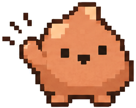

# Cloclod brand

## Idea

A *clod* is a lump of clay. Cloclod keeps the clod in its name: your app is clay you shape with Claude, and when you're happy you publish it, the way you fire clay in a kiln.

The mark is the clod itself, Cloclod's mascot: a small lump of clay that comes alive, like a pocket golem that's only half sculpted and that you finish shaping. It's the raw material you shape until it walks on its own.

The name also winks at "Cloclo", a French nickname for Claude. Keep that wink in the name only. Never use Anthropic's or Lovable's logos, colors as a reference, or wording. Before public launch, see "Trademark check" in [DECISIONS.md](../DECISIONS.md).

Write **Cloclod** in sentences: one word, with a capital C. Write `cloclod`, all lowercase, in ids, commands and the wordmark.

## The mark

- The clod's front pose, drawn flat on a 16 × 16 pixel grid: a light clay body (`#E88858`), a warm dark outline (`#3B1A10`) and a dark face (`#2A140C`).
- The clod's clay is lighter than the palette's `clay`, which stays the color of actions such as Publish. In the deeper clay the clod reads as brown, and a brown lump with a face looks like the poop emoji.
- Use it at 16, 24, 32, 48 or 64 px. At these sizes every square lands on whole pixels of a 2x screen; other sizes blur its edges.
- One version works on light and dark backgrounds.
- Keep its pixels square: never rotate it, scale it in an animation, or smooth it. On hover it hops.
- The lockup adds "cloclod" in Fraunces 600, stored as shapes, so every reader sees the same letters.
- `packages/design/src/logo.ts` draws both, and `scripts/export-brand.mts` writes the files in `docs/assets`. The plugin keeps a copy of the mark in `plugin/hooks/register.tsx`.

## The drawings

The character's own drawings are in [`docs/design/mascot`](mascot): its views and little adventures (Hello, Thinking, Building, Celebrating…), and the shapes it takes (Ask, Preview, Publish, Undo, a bridge, a house…).

- **The 16 × 16 mark** goes where the logo is small, and everywhere in Claude Desktop: the Publish bar, the panel, the preview toolbar, the favicon.
- **The drawings** go where there's room: the README header (Hello) and sections (Ask, Preview, Publish and Undo; the bridge; Still shaping), and GitHub's link preview.
- Show a drawing at its size or smaller. The sheets aren't on an exact pixel grid, so an enlarged drawing blurs.
- `scripts/mascot-assets.mts` cuts the drawings out of the sheets into `docs/assets/mascot`, and composes the link preview, `docs/assets/social-preview.png`. GitHub takes the preview from the repository's settings, not from a file.

## Palette: ceramic glazes

| Token | Light | Dark | Use |
|---|---|---|---|
| `clay` | `#B9502B` | `#E5764F` | Primary action (Publish), brand |
| `celadon` | `#2B7354` | `#6CC59E` | Live, success, healthy |
| `cobalt` | `#2D5BA6` | `#8AB0F0` | Information, links, focus |
| `ochre` | `#8F6210` | `#E6B356` | Warnings |
| `oxide` | `#B1281E` | `#F27B70` | Errors, destructive actions |
| `ink` / `ash` | `#1F1A16` / `#6B6158` | `#F3EEE7` / `#A79D92` | Text / secondary text |
| `paper` / `bisque` / `slip` | `#FBF8F3` / `#F4EEE6` / `#E7DED2` | `#15110E` / `#1E1915` / `#352D27` | Background / surfaces / borders |

All text pairs meet WCAG AA. `scripts/design-sheet.mts` renders the full sheet with every token to `docs/design/sheet.png`.

## Type

- **Product UI:** the system font. It feels native inside Claude Desktop and inside any app's preview.
- **Brand moments** (wordmark, docs headings): *Fraunces*, falling back to Iowan Old Style, Palatino or Georgia. It's a soft serif with a handmade warmth.
- Sizes are 11, 12, 13 (the UI base), 15, 18 and 24 px. Weights are 400, 500, 600 and 700. Keep tracking tight on display sizes (−0.4 px).

## Shape and motion

- Radii are 6, 10, 14 and 20 px, plus the pill. Surfaces feel like smooth stones, never sharp.
- Shadows are warm-tinted, low, and soft.
- Motion runs 120–260 ms with ease-out. A gentle spring is allowed once, when a surface enters. Nothing loops except progress, and `prefers-reduced-motion` turns off all non-essential motion.

## Voice

See [PRINCIPLES.md](PRINCIPLES.md). In short: short, warm, specific, and honest about risk. Clay words ("Shaping…") belong only in moments of delight, never in errors or anything about data.
