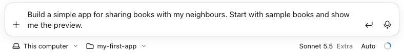

<!-- Généré à partir de guide.json et shared.json. Modifiez ces sources, pas ce fichier. -->

# Créer votre première application

[English](README.md)

Installez Clodable, décrivez votre idée et essayez votre première application.

Les captures sont en anglais. Les noms des boutons sont indiqués en français dans le texte.

## 1. Installer Clodable

Dans Claude Desktop, cliquez sur **Plugins**, puis **Ajouter** → **Ajouter une marketplace** → **Ajouter depuis un dépôt**.

Cliquez sur **Sélectionner un dépôt** et collez ce lien :

[https://github.com/bworlds-co/clodable](https://github.com/bworlds-co/clodable)

Validez avec **Utiliser « … »**, puis **Synchroniser**. Cliquez sur **Ajouter** à côté de **Clodable**.

Quand le bouton affiche **Ajouté**, Clodable est installé. Passez à la suite.

## 2. Créer un dossier pour votre application

Dans Claude, ouvrez l’onglet **Code** (icône **</>**), puis cliquez sur **Nouveau**. Choisissez **Cet ordinateur**, puis le menu des dossiers → **Ouvrir un dossier…**.

Créez un dossier vide avec **Nouveau dossier**, puis sélectionnez-le et cliquez sur **Ouvrir**.

## 3. Décrire votre application

Décrivez ce que vous voulez et envoyez votre message. Par exemple :

> Crée une application simple pour partager des livres avec mes voisins. Commence avec quelques livres d’exemple et montre-moi l’aperçu.

Claude crée une première version et ouvre un aperçu à côté de la conversation. Demandez vos modifications avec vos propres mots.

**L’aperçu n’apparaît pas ?** Demandez : « Montre-moi l’aperçu de mon application. »

**La barre Clodable n’apparaît pas ?** Envoyez `/clodable` dans votre session Code pour ouvrir le panneau.

## 4. Enregistrer quand vous êtes prêt

Choisissez **Configurer l’enregistrement**, connectez GitHub si nécessaire, puis cliquez sur **Créer l’application privée**.

L’enregistrement conserve votre code dans un espace privé. Il ne met pas votre application en ligne.

[Documentation officielle des plugins Claude](https://support.claude.com/en/articles/17740565-manage-plugins-skills-and-connectors-from-one-plugins-page)

---

Claude Desktop sur Mac · Captures : 23 novembre 2026 · Clodable 0.4.4

Captures réelles de Claude Desktop. Les libellés peuvent évoluer.
