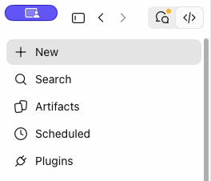

<!-- Généré à partir de guide.json et shared.json. Modifiez ces sources, pas ce fichier. -->

# Créer votre première application

[English](README.md)

Décrivez votre idée à Claude et créez votre première application avec Clodable.

Les captures sont en anglais. Les noms des boutons sont indiqués en français dans le texte.

## 1. Installer Clodable

Dans Claude Desktop, cliquez sur **Plugins**, puis **Ajouter** → **Ajouter une marketplace** → **Ajouter depuis un dépôt**.

Cliquez sur **Sélectionner un dépôt** et collez ce lien :

[https://github.com/bworlds-co/clodable](https://github.com/bworlds-co/clodable)

Validez avec **Utiliser « … »**, puis **Synchroniser**. Cliquez sur **Ajouter** à côté de **Clodable**.

Quand le bouton affiche **Ajouté**, Clodable est installé. Passez à la suite.

## 2. Créer un dossier pour votre application

Dans Claude, ouvrez l’onglet **Code** (icône **</>**), puis cliquez sur **Nouveau**. Choisissez **Cet ordinateur**, puis le menu des dossiers → **Ouvrir un dossier…**.

Créez un dossier vide avec **Nouveau dossier**, puis sélectionnez-le et cliquez sur **Ouvrir**.

## 3. Décrire votre idée à Claude

Écrivez à Claude ce que votre application doit permettre de faire. Par exemple :

> Crée une application pour partager des livres avec mes voisins. Ajoute quelques livres d’exemple et montre-moi l’aperçu.

Claude crée une première version. Essayez-la dans l’aperçu, à côté de la conversation, puis dites-lui ce que vous souhaitez changer.

**L’aperçu ne s’ouvre pas ?** Écrivez à Claude : « Montre-moi l’aperçu de mon application. »

**La barre Clodable n’apparaît pas ?** Dans la conversation de l’onglet Code, envoyez `/clodable` pour afficher le panneau.

## 4. Enregistrer votre travail sur GitHub

Cliquez sur **Configurer l’enregistrement**, connectez votre compte GitHub si nécessaire, puis cliquez sur **Créer l’application privée**.

Votre code est enregistré sur GitHub, en privé. Vous décidez ensuite quand mettre l’application en ligne.

[Documentation officielle des plugins Claude](https://support.claude.com/en/articles/17740565-manage-plugins-skills-and-connectors-from-one-plugins-page)

---

Claude Desktop sur Mac · Captures : 23 novembre 2026 · Clodable 0.4.4

Captures réelles de Claude Desktop. Les libellés peuvent évoluer.
