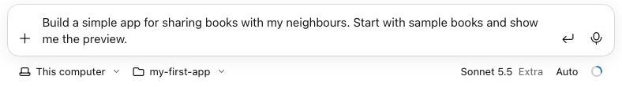

<!-- Generated from guide.json and shared.json. Edit those sources, not this file. -->

# Build your first app

[Français](README.fr.md)

Install Clodable, describe your idea, and try your first app.

Screenshots are shared across languages.

## 1. Install Clodable

Open **Plugins** in Claude Desktop. Choose **Add** → **Add marketplace** → **Add from a repository**.

Click **Select a repository** and enter:

[https://github.com/bworlds-co/clodable](https://github.com/bworlds-co/clodable)

Select **Use “…”**, then **Sync**. Click **Add** next to **Clodable**.

**Added** confirms installation. Already installed? Continue below.

## 2. Open an empty folder in Code

Click **Code** (the **</>** icon), then **New**. Choose **This computer**, then the folder menu → **Open folder…**.

Use **New Folder** to create an empty folder for your app. Select it and click **Open**.

## 3. Describe your app

Type what you want and send it. For example:

> Build a simple app for sharing books with my neighbours. Start with sample books and show me the preview.

Claude builds a first version and opens a preview beside the conversation. Ask for changes in your own words.

**No preview?** Ask: “Show me my app’s preview.”

**No Clodable bar?** Send `/clodable` in your Code session to open the panel.

## 4. Save it when you’re ready

Choose **Set up saving**, connect GitHub if asked, then choose **Create private app**.

Saving keeps your code private. It does not publish your app.

[Claude’s Plugins documentation](https://support.claude.com/en/articles/17740565-manage-plugins-skills-and-connectors-from-one-plugins-page)

---

Claude Desktop on Mac · Screenshots: 23 November 2026 · Clodable 0.4.4

Real Claude Desktop screenshots. Labels may change.
