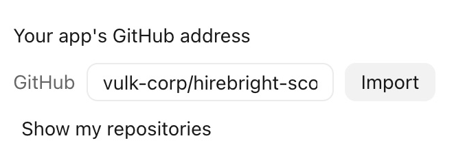
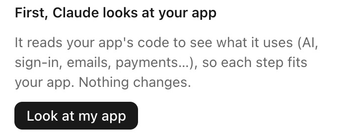

<!-- Généré à partir de guide.json et shared.json. Modifiez ces sources, pas ce fichier. -->

# Passer de Lovable à Clodable

[English](README.md)

Importez votre application Lovable, puis laissez Clodable vous guider.

Les captures sont en anglais. Les noms des boutons sont indiqués en français dans le texte.

## 1. Installer Clodable

Dans Claude Desktop, cliquez sur **Plugins**, puis **Ajouter** → **Ajouter une marketplace** → **Ajouter depuis un dépôt**.

Cliquez sur **Sélectionner un dépôt** et collez ce lien :

[https://github.com/bworlds-co/clodable](https://github.com/bworlds-co/clodable)

Validez avec **Utiliser « … »**, puis **Synchroniser**. Cliquez sur **Ajouter** à côté de **Clodable**.

Quand le bouton affiche **Ajouté**, Clodable est installé. Passez à la suite.

## 2. Copier le lien GitHub de votre application

Dans Lovable, ouvrez **Paramètres du projet → Git → GitHub**. Reliez votre application à GitHub si nécessaire, puis copiez son lien.

[Enregistrer votre application Lovable sur GitHub (guide officiel)](https://docs.lovable.dev/integrations/github)

## 3. Créer un dossier pour votre application

Dans Claude, ouvrez l’onglet **Code** (icône **</>**), puis cliquez sur **Nouveau**. Choisissez **Cet ordinateur**, puis le menu des dossiers → **Ouvrir un dossier…**.

Créez un dossier vide avec **Nouveau dossier**, puis sélectionnez-le et cliquez sur **Ouvrir**.

## 4. Importer votre application depuis GitHub

Dans la conversation, envoyez `/clodable` pour ouvrir le panneau Clodable. Cliquez sur **Importer une application depuis GitHub**. Si nécessaire, cliquez sur **Connecter GitHub** et connectez-vous au compte qui contient votre application.

Collez le lien GitHub de votre application, puis cliquez sur **Importer**. Patientez pendant que Clodable la récupère.

## 5. Suivre les étapes proposées par Clodable

Répondez aux questions de Claude sur votre application. Si le bouton **Examiner mon application** apparaît, cliquez dessus. Cliquez ensuite sur **Quitter Lovable**.

Dans le panneau qui s’ouvre, cliquez sur **Examiner mon application**. Clodable vous indiquera ensuite quoi faire, étape par étape.

Votre application reste en ligne sur Lovable jusqu’à ce que vous décidiez de passer à la nouvelle version.

---

Claude Desktop sur Mac · Captures : 23 novembre 2026 · Clodable 0.4.4

Ces captures ont été réalisées avec une copie de démonstration de HireBright, préparée pour reproduire sa configuration Lovable Cloud. Aucun service en ligne n’a été modifié.
