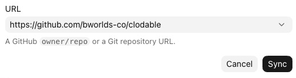
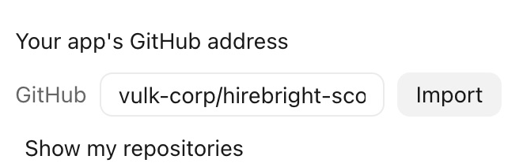
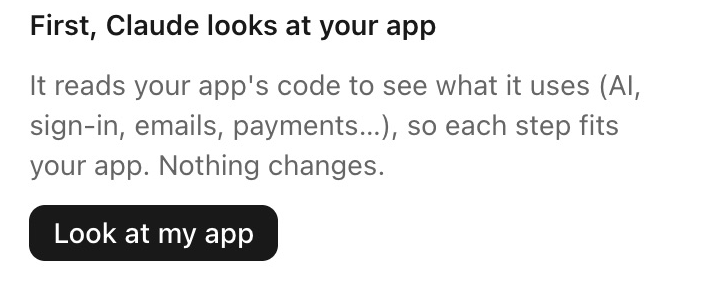

<!-- Generated from guide.json and shared.json. Edit those sources, not this file. -->

# Start moving from Lovable

[Français](README.fr.md)

Bring your Lovable app into Clodable, then follow the panel.

Screenshots are shared across languages.

## 1. Install Clodable

Open **Plugins** in Claude Desktop. Choose **Add** → **Add marketplace** → **Add from a repository**.

Click **Select a repository** and enter:

[https://github.com/bworlds-co/clodable](https://github.com/bworlds-co/clodable)

Select **Use “…”**, then **Sync**. Click **Add** next to **Clodable**.

**Added** confirms installation. Already installed? Continue below.

## 2. Copy your app’s GitHub link

In Lovable, open **Project settings → Git → GitHub**. Connect your app if needed, then copy its GitHub address.

[Save your Lovable app to GitHub (official guide)](https://docs.lovable.dev/integrations/github)

## 3. Open an empty folder in Code

Click **Code** (the **</>** icon), then **New**. Choose **This computer**, then the folder menu → **Open folder…**.

Use **New Folder** to create an empty folder for your app. Select it and click **Open**.

## 4. Bring your app from GitHub

Send `/clodable` to open the panel. Click **Bring an app from GitHub**. If asked, choose **Connect GitHub** and sign in with the account that can access your app.

Paste your app’s GitHub address, then click **Import**. Wait for setup to finish.

## 5. Start the guided move

Answer any setup questions Claude asks. If the panel offers **Look at my app**, click it first. Then choose **Move off Lovable**.

Click **Look at my app**, then follow the panel’s instructions one step at a time.

Your live app stays on Lovable until you choose to switch.

---

Claude Desktop on Mac · Screenshots: 23 November 2026 · Clodable 0.4.4

Migration screenshots use an isolated HireBright demo configured for its documented Lovable Cloud setup. No live services were changed.
