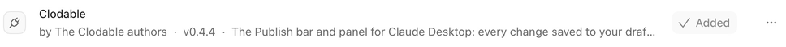
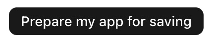
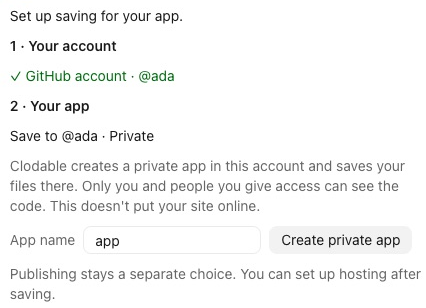

<!-- Généré à partir de guide.json et shared.json. Modifiez ces sources, pas ce fichier. -->

# Reprendre votre projet avec Clodable

[English](README.md)

Votre application est déjà sur votre ordinateur ? Ouvrez-la dans Claude, enregistrez son code sur GitHub et mettez-la en ligne quand elle est prête.

Les captures sont en anglais. Les noms des boutons sont indiqués en français dans le texte.

## 1. Installer Clodable

Dans Claude Desktop, cliquez sur **Plugins**, puis **Ajouter** → **Ajouter une marketplace** → **Ajouter depuis un dépôt**.

Cliquez sur **Sélectionner un dépôt** et collez ce lien :

[https://github.com/bworlds-co/clodable](https://github.com/bworlds-co/clodable)

Validez avec **Utiliser « … »**, puis **Synchroniser**. Cliquez sur **Ajouter** à côté de **Clodable**.

Quand le bouton affiche **Ajouté**, Clodable est installé. Passez à la suite.

## 2. Ouvrir le dossier de votre application

Dans Claude, ouvrez l’onglet **Code** (icône **</>**), puis cliquez sur **Nouveau**. Choisissez **Cet ordinateur**, puis le menu des dossiers → **Ouvrir un dossier…**.

Choisissez le dossier qui contient votre application, puis cliquez sur **Ouvrir**. Dans la conversation, envoyez `/clodable` pour afficher le panneau.

> **Au premier démarrage**
>
> Clodable vérifie les outils nécessaires et peut en télécharger sur votre ordinateur. Cela peut prendre quelques minutes.
>
> Si le bouton **Installer Git** apparaît, cliquez dessus et suivez les instructions dans la fenêtre Apple. Une fois l’installation terminée, revenez dans Clodable et cliquez sur **Vérifier à nouveau**.

## 3. Vérifier l’application avec Claude

Si le bouton **Préparer mon application pour l’enregistrement** apparaît, cliquez dessus. Claude vous explique les ajustements nécessaires, puis vous aide à les faire.

Répondez à ses questions, puis essayez votre application dans l’aperçu.

Si votre application fonctionne déjà avec Clodable, passez à **Configurer l’enregistrement**.

## 4. Enregistrer votre travail sur GitHub

Cliquez sur **Configurer l’enregistrement**. Si Clodable vous le demande, cliquez sur **Connecter GitHub** et connectez-vous à votre compte.

Vérifiez le compte GitHub affiché et le nom de votre application. Cliquez sur **Créer l’application privée**, puis attendez le message de confirmation.

Votre code est enregistré en privé sur GitHub. Cette étape ne met pas votre application en ligne.

**Votre application est déjà sur GitHub ?** Cliquez sur **Configurer Clodable ici** pour conserver le même projet GitHub.

**Vous êtes bloqué ?** Cliquez sur **Demander de l’aide à Claude**. Vérifiez ensuite le résultat dans l’aperçu, puis revenez au panneau pour enregistrer votre application.

## 5. Connecter votre compte Netlify

**Votre application est déjà en ligne ?** Donnez à Claude son adresse et le nom de l’hébergeur pour qu’il vérifie la configuration. Sinon, suivez les étapes ci-dessous.

Cliquez sur **Configurer l’hébergement**, puis sur **Ouvrir la page des tokens Netlify ↗**. Sur Netlify, connectez-vous et créez un token personnel nommé **Clodable**. Ce token permet à Clodable de publier votre application sur Netlify.

Collez ce token dans le champ **Token Netlify**, puis cliquez sur **Connecter**. Choisissez votre équipe si Clodable vous le demande, puis cliquez sur **Créer mon adresse web**.

Collez le token dans le panneau Clodable, sans l’envoyer dans la conversation.

[Créer un token personnel Netlify : documentation officielle](https://docs.netlify.com/api-and-cli-guides/api-guides/get-started-with-api/#authentication)

## 6. Publier votre application

Essayez votre application dans l’aperçu. Quand tout fonctionne, cliquez sur **Publier**. Dès que le message **Votre site est en ligne !** apparaît, ouvrez le lien et vérifiez aussi la version en ligne.

**Votre application a des comptes utilisateurs ou une base de données ?** Demandez à Claude de vérifier leur configuration avant de publier. S’il vous propose **Ajouter un backend**, suivez ses instructions et vérifiez le compte et le coût avant de confirmer.

---

Claude Desktop sur Mac · Captures : 23 novembre 2026 · Clodable 0.4.4

Captures réelles d’environnements de démonstration. Les comptes affichés sont des exemples. Aucune application n’a été publiée pour ce guide.
