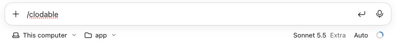
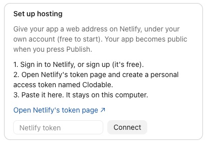
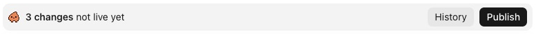

<!-- Généré à partir de guide.json et shared.json. Modifiez ces sources, pas ce fichier. -->

# Préparer votre application existante

[English](README.md)

Ouvrez votre dossier, enregistrez sur GitHub et préparez l’hébergement.

Les captures sont en anglais. Les noms des boutons sont indiqués en français dans le texte.

## 1. Installer Clodable

Dans Claude Desktop, cliquez sur **Plugins**, puis **Ajouter** → **Ajouter une marketplace** → **Ajouter depuis un dépôt**.

Cliquez sur **Sélectionner un dépôt** et collez ce lien :

[https://github.com/bworlds-co/clodable](https://github.com/bworlds-co/clodable)

Validez avec **Utiliser « … »**, puis **Synchroniser**. Cliquez sur **Ajouter** à côté de **Clodable**.

Quand le bouton affiche **Ajouté**, Clodable est installé. Passez à la suite.

## 2. Ouvrir le dossier de votre application dans Code

Cliquez sur **Code** (l’icône **</>**), puis **Nouveau**. Choisissez **Cet ordinateur**, puis le menu des dossiers → **Ouvrir un dossier…**.

Sélectionnez le dossier de votre application et cliquez sur **Ouvrir**. Envoyez `/clodable` pour ouvrir le panneau.

## 3. Préparer l’application si nécessaire

Si le panneau propose **Préparer mon application pour l’enregistrement**, cliquez dessus. Claude adapte la configuration et vérifie les fonctionnalités existantes.

Répondez aux questions et vérifiez le résultat dans l’aperçu.

Votre application est déjà compatible ? Passez directement à **Configurer l’enregistrement**.

## 4. Enregistrer votre code sur GitHub en privé

Cliquez sur **Configurer l’enregistrement**. Si nécessaire, choisissez **Connecter GitHub** et suivez les étapes de connexion.

Vérifiez votre compte et le nom de l’application, puis cliquez sur **Créer l’application privée**. Attendez la confirmation de l’enregistrement.

Votre code reste privé. L’enregistrement ne met pas votre application en ligne.

**Votre application est déjà sur GitHub ?** Choisissez **Configurer Clodable ici** pour conserver ce lien.

**La configuration bloque ?** Choisissez **Demander de l’aide à Claude**, vérifiez l’aperçu, puis revenez au panneau d’enregistrement.

## 5. Configurer l’hébergement

**Votre site est déjà en ligne ?** Indiquez à Claude son hébergeur et son adresse pour qu’il vérifie la configuration. Suivez les étapes ci-dessous si vous n’avez pas encore d’hébergement.

Choisissez **Configurer l’hébergement**, puis **Ouvrir la page des tokens Netlify ↗**. Connectez-vous et créez un token personnel nommé **Clodable**.

Collez le token dans le champ **Token Netlify** et cliquez sur **Connecter**. Choisissez votre équipe si nécessaire, puis cliquez sur **Créer mon adresse web**.

Saisissez les tokens dans le panneau, jamais dans la conversation.

[Créer un token personnel Netlify : documentation officielle](https://docs.netlify.com/api-and-cli-guides/api-guides/get-started-with-api/#authentication)

## 6. Publier quand tout est prêt

Essayez votre application dans l’aperçu et corrigez les problèmes signalés par Clodable. Cliquez sur **Publier**. Lorsque **Votre site est en ligne !** s’affiche, ouvrez l’adresse du site et testez-le.

**Votre application utilise des comptes ou une base de données ?** Demandez à Claude de vérifier les services et les paramètres avant de publier. Si vous avez besoin d’un backend, suivez **Ajouter un backend** avec Claude et vérifiez le compte et le coût indiqués dans le panneau.

---

Claude Desktop sur Mac · Captures : 23 novembre 2026 · Clodable 0.4.4

Captures réelles d’environnements de démonstration. Les comptes affichés sont des exemples. Aucune application n’a été publiée pour ce guide.
