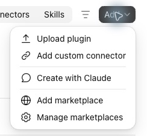
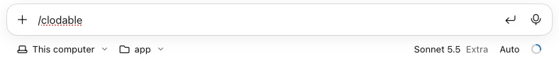
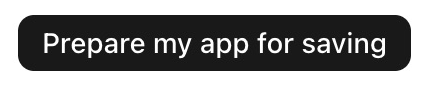
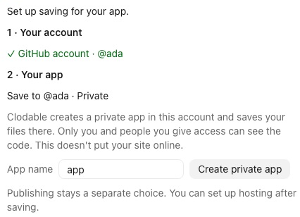
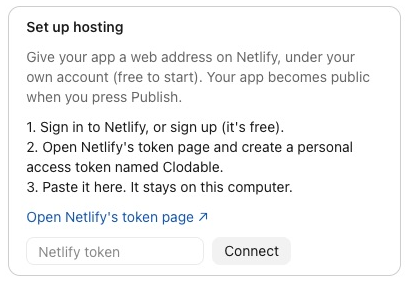
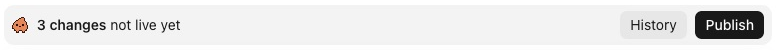

<!-- Generated from guide.json and shared.json. Edit those sources, not this file. -->

# Prepare your existing app

[Français](README.fr.md)

Open your folder, save to GitHub, and prepare hosting.

Screenshots are shared across languages.

## 1. Install Clodable

Open **Plugins** in Claude Desktop. Choose **Add** → **Add marketplace** → **Add from a repository**.

Click **Select a repository** and enter:

[https://github.com/bworlds-co/clodable](https://github.com/bworlds-co/clodable)

Select **Use “…”**, then **Sync**. Click **Add** next to **Clodable**.

**Added** confirms installation. Already installed? Continue below.

## 2. Open your existing folder in Code

Click **Code** (the **</>** icon), then **New**. Choose **This computer**, then the folder menu → **Open folder…**.

Select your app’s existing folder and click **Open**. Send `/clodable` to open the panel.

## 3. Prepare the app if needed

If the panel offers **Prepare my app for saving**, click it. Claude adapts the setup and checks your app’s existing features.

Answer any questions and review the preview.

Already compatible? Go straight to **Set up saving**.

## 4. Save privately to GitHub

Click **Set up saving**. If asked, choose **Connect GitHub** and follow the sign-in steps.

Check your account and app name, then click **Create private app**. Wait for the saved confirmation.

Your code is private. Saving does not publish your app.

**Already connected to GitHub?** Choose **Set up Clodable here** to use that existing app.

**Setup needs help?** Choose **Ask Claude for help**, check the preview, then return to the saving panel.

## 5. Set up hosting

**Already online?** Tell Claude the current host and web address so it can check your setup. Use the steps below when your app has no hosting.

Choose **Set up hosting**, then **Open Netlify's token page ↗**. Sign in and create a personal access token named **Clodable**.

Paste the token into **Netlify token** and click **Connect**. Choose your team if asked, then click **Create my web address**.

Keep tokens in the panel, not the conversation.

[Netlify’s personal access token instructions](https://docs.netlify.com/api-and-cli-guides/api-guides/get-started-with-api/#authentication)

## 6. Publish when you’re ready

Try your app in the preview and resolve any checks Clodable reports. Press **Publish**. When **You're live!** appears, open the web address and try the app there.

**Uses sign-in or a database?** Ask Claude to check your existing services and settings before publishing. If you need a new backend, let Claude guide you through **Add a backend** and review the account and cost shown in the panel.

---

Claude Desktop on Mac · Screenshots: 23 November 2026 · Clodable 0.4.4

Real screenshots from demo workspaces. Example accounts are shown. No live app was published for this guide.
